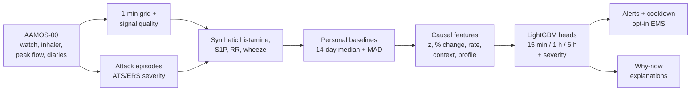

# Asthma Early Warning

**Predicting asthma attacks before symptoms start, from implanted biomarker sensors and a smartwatch.**

[](../../actions/workflows/tests.yml)

A Rice University bioengineering team project. The device pairs two
implanted electrochemical sensors (histamine in interstitial fluid,
sphingosine-1-phosphate in plasma) with a smartwatch and phone (heart rate,
respiratory rate, wheeze). This repository holds the machine-learning
pipeline that turns those signals into a personal risk score:

- **Likelihood** of an attack in the next 15 minutes, 1 hour and 6 hours
- **Severity** if one is coming (moderate or worse, severe), using ATS/ERS 2009 definitions
- **"Why now?"** in plain language, e.g. *"histamine is +268% from your normal"*



## Results

Leave-one-person-out on 20 people and 121 attack episodes: the model never sees
the person it is tested on.

> **Read this first.** Heart rate, activity and attack timing are real
> (AAMOS-00). Histamine, S1P, respiratory rate and wheeze are **synthetic**,
> because no public dataset pairs continuous biomarkers with attack labels.
> These numbers test the pipeline and design choices, not clinical accuracy.

**Ranking quality (AUROC):**

| Window | Full model | HR-only model | 2-of-3 rule |
| --- | --- | --- | --- |
| 15 min | **0.78** | 0.49 | 0.73 |
| 1 h | **0.77** | 0.53 | 0.63 |
| 6 h | **0.68** | 0.49 | 0.60 |

**Attacks caught with at most 1 false alarm per day:**

| Window | Full model | HR-only model | 2-of-3 rule |
| --- | --- | --- | --- |
| 15 min | **40%** | 0% | 0% |
| 1 h | **53%** | 1% | 0% |
| 6 h | **55%** (median 4 h warning) | 6% | 0% |

What this shows:

- **Heart rate alone does not predict attacks** in this data (AUROC near 0.5), which is why the device adds biomarker sensors.
- **The model beats the simple rule when false alarms must stay rare.** At a looser budget (3 per day) the rule catches more 6-hour attacks (76% vs 64%), because sustained S1P makes it fire for hours. That trade-off is a design question for the team.
- **Severity is not learnable yet** (AUROC below 0.5): the synthetic signals barely differ by severity, and real severity data is needed.

Full tables: [`docs/results.md`](docs/results.md).

## Run it

```bash
pip install -e ".[dev]"
pytest                                  # 14 tests, no data needed
# Put the AAMOS-00 CSVs in data/raw/aamos00/ (see data/README.md), then:
python scripts/run_pipeline.py --users 113 190 217 454 473   # quick run, a few minutes
python scripts/run_pipeline.py                               # all 20 people, about 15 minutes
```

Every number (windows, baseline length, alert rules, model settings) is in
[`configs/default.yaml`](configs/default.yaml).

## Repository layout

```text
src/asthma_ew/
  data.py        load AAMOS-00, 1-minute grid, signal quality
  labels.py      attack episodes and ATS/ERS severity
  synthetic.py   histamine, S1P, respiratory rate, wheeze
  baseline.py    personal baselines (past 14 days only)
  features.py    causal features
  dataset.py     targets and sampling
  models.py      LightGBM heads
  evaluate.py    leave-one-person-out metrics, threshold tuning
  alerts.py      alert cooldown and opt-in EMS logic
  explain.py     "why now?" explanations
  gru.py         two-branch GRU (roadmap, not trained yet)
  pipeline.py    ties the steps together
scripts/run_pipeline.py
tests/           unit tests, including a no-look-ahead check
physiology/matlab/   the team's airway airflow model (Weibel Gens 0-16)
docs/            architecture, data and limitations, privacy, results
```

## Privacy by design

Raw data never leaves the phone: the app is designed for federated learning,
where only model updates are shared. Location triggers, provider sharing and
emergency calls are **opt-in**, each explained before it turns on. See
[`docs/privacy.md`](docs/privacy.md).

## Team

| Name | Role |
| --- | --- |
| Jana Robert-Oragbon | ML and software: this pipeline; airway model Gens 0-4 |
| Anna | Airway model Gens 5-16 |
| Ryan | Alveolar model; sensor and biomarker decisions |
| Adeline | Team member |
| Bolu | Team member |
| Kevin | Team member |
| Emi | Team member |

## References

- Tsang KCH et al. Home monitoring with connected mobile devices for asthma attack prediction with machine learning. *Scientific Data* 10, 370 (2023). (AAMOS-00 dataset)
- Reddel HK et al. An official ATS/ERS statement: asthma control and exacerbations. *AJRCCM* 180, 59-99 (2009).
- Ke G et al. LightGBM: a highly efficient gradient boosting decision tree. *NeurIPS* (2017).
- McMahan B et al. Communication-efficient learning of deep networks from decentralized data. *AISTATS* (2017).

## License

Code: MIT (see [LICENSE](LICENSE)). The AAMOS-00 data is not included and
keeps its own Edinburgh DataShare license.
