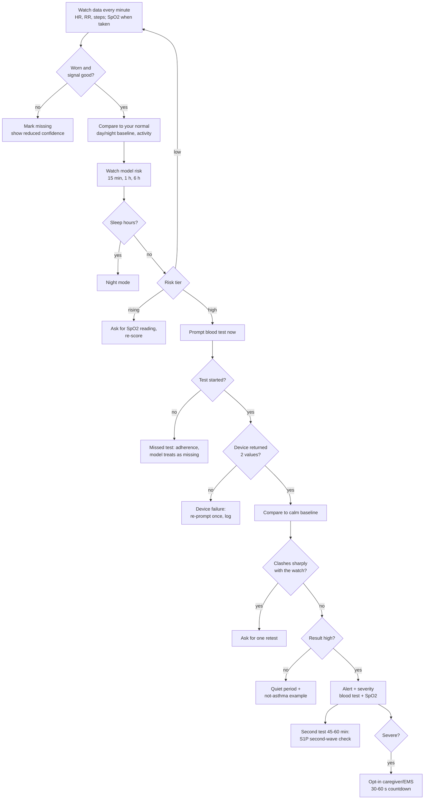

# System design (v0.2, Nov 19 2026)

The device is a wrist wearable plus a portable finger-prick blood test. The
watch runs all the time and decides **when** a test is worth taking; the blood
test **confirms** the attack and **grades** its severity. The goal is
unchanged: predict time until an attack and how severe it will be.

This replaces the v0.1 design, which assumed an implant reading histamine and
S1P every minute. The v0.1 code and results in this repo still reflect that
design; v0.3 (next) rebuilds the pipeline for this one.

## Hardware, as the model sees it

| Source | What the app receives | How often |
| --- | --- | --- |
| Wrist wearable (Apple Watch-style) | Heart rate, breathing rate, steps, activity | Every minute |
| Wrist wearable | SpO2 | Now and then (background, mostly when still) + on demand |
| Blood test device (abbieSense-style) | 2 final values: histamine, S1P (plasma) | Only when a test is taken |
| Blood test device | Timestamp each time a test is started | Every test |

The blood test device does its own averaging (duplicate electrodes), background
subtraction (blank electrode) and reliability checks, like the Wyss abbieSense
/ eRapid sensors. The model never averages or filters raw test values.

## App flow

### Rules inside the flow

- **Exercise:** HR and RR are compared to the user's normal for the current
  activity, so exercise alone never prompts a test. It still prompts if SpO2
  drops or vitals don't recover after exercise stops. Tests within 30 min of
  exercise are flagged (exercise raises plasma S1P on its own).
- **Prompts:** no daily maximum; a quiet period after a normal test.
- **Manual tests:** any time, no limit; saved with a user-started flag.
- **Calm test:** once a day at the same time; the blood baseline is the median
  of calm tests (histamine follows a 24-hour cycle).
- **Severity:** histamine and S1P rise over calm baseline, plus SpO2 under 95%
  (moderate-to-severe) and under 92% (severe).
- **Alerts:** "why now?" reasons in plain words; 30 min cooldown unless risk
  rises a level; one-tap feedback after each alert; inhaler response check.
- **Emergency contact:** opt-in only, explained first, with a 30-60 s countdown.

### Night mode (Dexcom / FreeStyle Libre approach)

1. No test prompts during sleep hours; the watch keeps watching.
2. A warning signal must last a few minutes before anything fires.
3. **Urgent tier** (high risk + SpO2 drop, or HR/RR alone if there is no recent
   SpO2): wake the user and alert immediately, never waiting for a test. It can
   be silenced for a set time but never turned off.
4. Not urgent: flag it and prompt a morning check-in test, saved as a training
   example.
5. Opt-in caregiver sharing of urgent night alerts.

## Model

| Output | Used for |
| --- | --- |
| Risk of an attack in 15 min, 1 h, 6 h (watch model) | Deciding when to prompt a test |
| At least moderate? Severe? | Severity grade and the EMS path |
| Chance of a late second wave | Second-wave warning |

Features per watch signal: value, % change and z-score vs personal baseline,
rate of change (15 min, 24 h), threshold crossed, last-hour variability,
quality score. SpO2: latest value + time since reading. Blood: result vs calm
baseline, test taken?, time since test, exercise flag. Profile: responder type,
allergen, medications. One LightGBM model per output; a shallow GRU is the
planned upgrade.

### Training data

1. Real AAMOS-00 watch HR, inhaler, peak flow and diaries.
2. Attack labels from the ATS/ERS 2009 definitions.
3. Synthetic histamine, S1P, breathing rate and SpO2 curves from published
   studies, tied to real attack times.
4. Simulated prompts: the watch model decides when a test would be asked.
5. Simulated people: 60-80% of prompts answered (stress test at 40%), delays,
   device failures.
6. Biomarkers appear in the training set only where a simulated test happened.

### Testing

Leave-one-person-out, with thresholds tuned on separate people. Scored at the
event level (caught if an alert fired before onset), target warning 15 min,
under two alarm limits: normal-test prompts about 1 per day while learning,
and at most 1 false attack alert per week. Compared against an HR-only model,
the 2-of-3 rule and the v0.1 continuous design.

### Personalization

Population defaults on day 1, blended toward personal baselines over 14 days.
Baselines recomputed nightly from good-quality minutes, skipping attacks and
48 h after. Every normal test becomes a not-asthma example; every alert's
feedback becomes a label. Guardrails: freeze updates during attacks, cap weight
changes, drift check. Opt-in federated learning shares model updates only.

Every number above is in [`configs/design_v0.2.yaml`](../configs/design_v0.2.yaml).
Why each choice was made: [`decisions.md`](decisions.md). Sources: [`sources.md`](sources.md).
